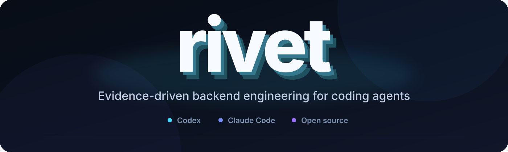

<p align="center">
  
</p>

<p align="center">
  <a href="https://github.com/joinotto/rivet/actions/workflows/ci.yml"></a>
  <a href="./LICENSE"></a>
  <a href="./SECURITY.md"></a>
  <a href="https://github.com/joinotto/rivet/actions/workflows/scorecard.yml"></a>
</p>

<p align="center">
  <a href="#quick-start">Quick Start</a> ·
  <a href="#supported-hosts">Supported Hosts</a> ·
  <a href="#features">Features</a> ·
  <a href="./docs/ROADMAP.md">Roadmap</a> ·
  <a href="./CONTRIBUTING.md">Contributing</a> ·
  <a href="./SECURITY.md">Security</a>
</p>

Rivet is an open-source backend engineering skill for Codex and Claude Code.
It combines explicit invariants, database and system-design guidance, selected
repository checks, and evidence receipts. Your project owns its tools, data,
permissions, and model-provider configuration.

Status: development preview. Version `0.1.0` is designated as an unsigned
development prerelease for isolated evaluation. It is not a supported
production release. Production publication requires the
[release requirements](docs/RELEASING.md).

## Why Rivet

- Understand a project's constraints before changing it.
- Design databases, APIs, jobs, and distributed workflows with explicit invariants.
- Reuse existing tests and security tools.
- Separate observed results from assumptions and missing evidence.
- Keep the skill local and retain your selected model provider.
- Preserve user files during installation, upgrade, and removal.

## Quick Start

Use a maintained Node.js 22 runtime. Clone and review this repository, then
install into an existing backend project:

```sh
git clone https://github.com/joinotto/rivet.git
cd rivet
node scripts/install-skill.mjs install \
  --host codex --project /absolute/path/backend --dry-run
node scripts/install-skill.mjs install \
  --host codex --project /absolute/path/backend
```

For Claude Code, use `--host claude-code`.

Start the coding tool in the backend project. Invoke `$rivet` in Codex or
`/rivet` in Claude Code. Ask it to inspect the repository and preview detected
checks. Review commands before approving execution.

See [getting started](docs/getting-started.md) and
[installation and recovery](docs/INSTALLATION.md) for first use, packaged
installation, upgrade, removal, and rollback.

## Supported Hosts

| Coding tool | Project discovery path | Model configuration |
| --- | --- | --- |
| Codex | `.agents/skills/rivet` | Existing provider settings are preserved |
| Claude Code | `.claude/skills/rivet` | Existing provider settings are preserved |

These are the only active distributions. Other hosts are deferred in the
[roadmap](docs/ROADMAP.md). See [host integrations](docs/HOST-INTEGRATIONS.md) for
permission boundaries and platform limitations.

## Features

- TRACE reasoning: target behavior, record facts and unknowns, analyze risks,
  compare material alternatives, and verify the change.
- Database guidance for modeling, normalization, indexes, transactions, and
  migrations.
- Repository discovery, change impact, and selected test execution.
- Coverage, mutation, property, contract, and flake evidence.
- Secret redaction, dependency-risk evidence, security findings, and threat models.
- Read-only PostgreSQL migration and saved-query-plan inspection.
- Retry, idempotency, observability, performance, and release analysis.
- Structured evidence with distinct pass, fail, incomplete, and
  insufficient-evidence results.

The runtime and installer have no third-party runtime dependencies. Advanced
checks use your project's declared tools and supplied evidence. A valid schema
or passing local check does not prove that a production system is safe.

## Verification

From a project with the Codex installation:

```sh
node .agents/skills/rivet/scripts/rivet-evidence.mjs inspect
node .agents/skills/rivet/scripts/rivet-evidence.mjs doctor
node .agents/skills/rivet/scripts/rivet-evidence.mjs verify --dry-run
```

For Claude Code, use `.claude/skills/rivet/scripts/rivet-evidence.mjs`.

Warning: repository checks can execute arbitrary code. Review the command,
working directory, network use, and credentials before approving a check.

If the preview lists a check named `test`:

```sh
node .agents/skills/rivet/scripts/rivet-evidence.mjs verify --checks test --json
```

Use the check identifiers detected in your project.

## Project Rules

- Keep engineering guidance in one canonical skill.
- Preserve project architecture and model-provider settings.
- Require authorization for active tests, network use, and external changes.
- Keep credentials, customer data, and private security findings out of public output.
- Report failed and unavailable checks without converting them into passes.
- Do not present inferred results as observed evidence.

## Documentation

- [Documentation index](docs/README.md): usage, engineering references, and
  project policies.
- [Getting started](docs/getting-started.md)
- [Installation and recovery](docs/INSTALLATION.md)
- [Commands and workflows](docs/COMMAND-CATALOG.md)
- [Roadmap](docs/ROADMAP.md)
- [Contributing](CONTRIBUTING.md)
- [Support](SUPPORT.md)
- [Changelog](CHANGELOG.md)

## Compatibility

The runtime and installer use ECMAScript modules. CI tests Node.js 16 and 22.
Use a maintained Node.js 22 runtime for deployment. Runtime compatibility does
not extend the upstream support life of an older Node.js version.

Rivet follows Semantic Versioning for its CLI, schemas, adapters, and skill
interfaces. Host permissions are not an operating-system sandbox.

## Support

Rivet has community support for the two declared coding tools. Use issue forms
for reproducible defects and documentation problems. Report a new vulnerability
privately through [the security policy](SECURITY.md).
See [support](SUPPORT.md) for scope and limitations.

## License

Rivet uses the Apache License 2.0. See [LICENSE](LICENSE) and [NOTICE](NOTICE).
